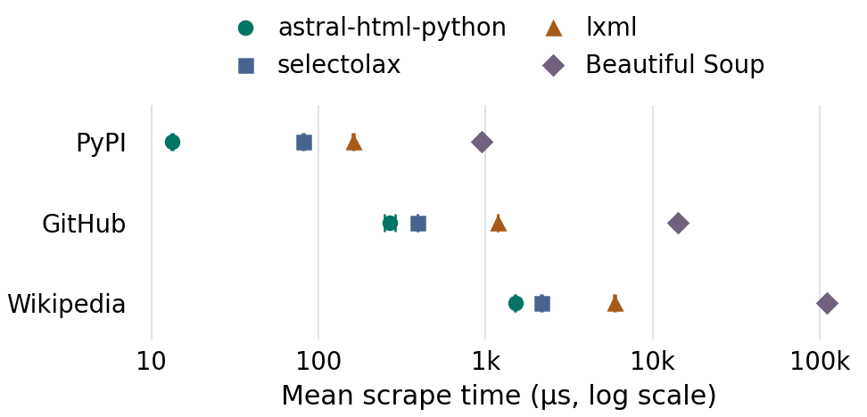

# astral-html-python

> [!WARNING]
>
> This project is an experiment in developing a library using Codex. The content below the line, as well as all the code, are written by Codex.

---

A very fast HTML parser with CSS selectors for Python web scrapers. It’s written
in Rust and uses the [astral-html](https://github.com/astral-sh/astral-html) tokenizer.

<!-- Keep chart paths relative so GitHub shows the images from the revision being viewed. -->
<p align="center">
  <picture>
    <source media="(prefers-color-scheme: dark)" srcset="benchmarks/filtered-links-dark.png">
    
  </picture>
</p>

Each parser reads a saved page and extracts the URLs and text of links matching
a page-specific CSS selector. Bars show mean time per scrape across 12 fresh
processes. Whiskers show one standard error, and each page has its own scale.
[Three-snapshot results](https://github.com/astral-experiments/astral-html-python/blob/main/benchmarks/README.md#time-per-operation) ·
[1,867-page corpus results](https://github.com/astral-experiments/astral-html-python/blob/main/benchmarks/wcxb.md)

## Quick start

From the repository root, use `uv` and Rust 1.97 or newer to build the
extension and start Python. This example uses CPython 3.14. For 3.15, change
`--python 3.14` to `--python 3.15`.

```sh
uv run --locked --python 3.14 python
```

Pass the page HTML as a string, then select the links that have an `href`.

```python
from astral_html import parse

html = """
<main>
    <a href="/guide">Read <b>the guide</b></a>
    <a>Draft</a>
</main>
"""
doc = parse(html)

links = []
for link in doc.select("main a[href]"):
    href = link["href"]
    links.append((href, link.text))

print(links)  # [('/guide', 'Read the guide')]
```

The tree follows nesting in the source. For example, in `<ul><li>A<li>B</ul>`
the second `li` is a child of the first, so `select("ul > li")` returns one
item with the text `"AB"`.

[Parsing and CSS queries](https://github.com/astral-experiments/astral-html-python/blob/main/docs/parsing.md) ·
[Development guide](https://github.com/astral-experiments/astral-html-python/blob/main/docs/development.md)

Licensed under MIT or Apache-2.0.
